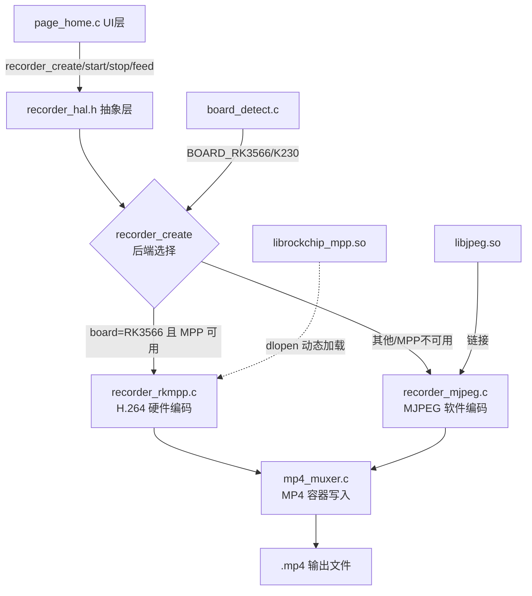
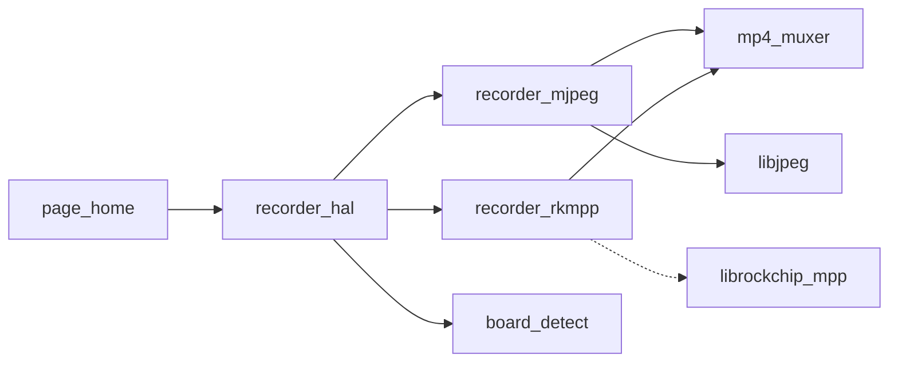

# 设计文档：MP4 视频录制（双后端架构）

## 1. 需求对齐（Align）

### 原始需求
实现视频录制，视频规格为 MP4。

### 边界确认
- **范围**：将现有 MJPEG+AVI 软件录制升级为 MP4 容器；RK3566 平台新增 H.264 硬件编码后端
- **不在范围**：4K60 录制（受 GC2093 摄像头硬件限制，仅预留接口）、视频播放、音频录制
- **决策**：双后端架构（RK3566=MPP H.264+MP4，K230/PC=MJPEG+MP4），不保留 AVI 回退

### 验收标准
1. RK3566 上录制输出 H.264+MP4，VLC/系统播放器可正常播放
2. K230/PC 上录制输出 MJPEG+MP4，VLC 可正常播放
3. 录制期间预览不卡顿（UI 线程 feed_frame <1ms）
4. 输出文件扩展名 `.mp4`，相册可识别
5. K230 平台编译通过（无 librockchip_mpp 时自动回退软件后端）

## 2. 架构设计（Architect）

### 整体架构图



### 模块依赖



### 模块设计

#### 2.1 mp4_muxer.h/c（新增，共用组件）
MP4 容器写入器，支持 MJPEG 和 H.264 两种 sample 类型。

**核心接口：**
```c
typedef enum {
    MP4_TRACK_MJPEG = 0,   /* MJPEG 帧（每帧独立，全关键帧） */
    MP4_TRACK_H264  = 1,   /* H.264 NALU（AVCC 格式，4字节长度前缀） */
} mp4_track_type_t;

typedef struct mp4_muxer mp4_muxer_t;

mp4_muxer_t * mp4_muxer_create(const char *path, int width, int height,
                                int fps, mp4_track_type_t track_type);
int mp4_muxer_write_sample(mp4_muxer_t *m, const uint8_t *data, size_t size,
                            int is_keyframe);
int mp4_muxer_close(mp4_muxer_t *m);
```

**MP4 文件结构：**
```
ftyp (file type: isom/iso2/mp41)
moov (movie box)
  mvhd (movie header: timescale, duration)
  trak (track)
    tkhd (track header: width, height)
    mdia
      mdhd (media header: timescale)
      hdlr (handler: vide)
      minf
        vmhd
        dinf/dref
        stbl
          stsd (sample description: mjpa 或 avc1)
          stts (time to sample)
          stsc (sample to chunk)
          stsz (sample sizes)
          stco (chunk offsets)
mdat (media data: 实际帧数据)
```

**写入策略：** 先写 ftyp，再用占位写 moov（大小未知），然后写 mdat（记录每帧偏移和大小），最后回填 moov 的实际大小和表格。
**H.264 特殊处理：** Annex-B 流 → AVCC 格式（SPS/PPS 提取到 avcC box，NALU 用 4字节长度前缀替代 0x00000001 起始码）。

#### 2.2 recorder_mjpeg.c（改造）
- 保持线程化异步架构（UI 线程 feed_frame 入队，工作线程编码）
- 将 AVI 写入函数（avi_write_header/frame/tail）替换为 mp4_muxer 调用
- MJPEG 编码逻辑（libjpeg RGB888→JPEG）保持不变
- `recorder_is_available` 始终返回 1（软件后端兜底）

#### 2.3 recorder_rkmpp.c（新增）
- 仅 aarch64 平台编译（`#if defined(__aarch64__)`），其他平台编译为空实现返回 unavailable
- dlopen 加载 `librockchip_mpp.so`，失败返回 NULL
- MPP 编码流程：
  1. `mpp_create` + `mpp_init(ctx, ENC, H264)`
  2. 配置编码参数（分辨率、帧率、码率、GOP）
  3. 输入帧：camera_frame_t → MppFrame（NV12/YUYV 直送，RGB565 需软件转 NV12）
  4. `mpi->encode(ctx, frame, &packet)` 同步编码
  5. 输出 H.264 NALU → mp4_muxer
- 线程化异步架构（与 mjpeg 后端一致）

#### 2.4 recorder_hal.h（修改）
- 接口签名不变（保持向后兼容）
- `recorder_create` 内部增加后端选择逻辑：
  - 若 `cfg.codec == H264` 且平台为 RK3566 且 dlopen MPP 成功 → 用 rkmpp 后端
  - 否则回退 mjpeg 后端（并强制 codec=MJPEG）

## 3. 任务拆分（Atomize）

| 任务 | 输入 | 输出 | 依赖 |
|------|------|------|------|
| T1: mp4_muxer.h/c | 设计文档 | MP4 容器写入器（支持 MJPEG+H264） | 无 |
| T2: 改造 recorder_mjpeg.c | T1 | MJPEG+MP4 软件后端 | T1 |
| T3: 新增 recorder_rkmpp.c | T1 | H.264+MP4 硬件后端 | T1 |
| T4: 修改 recorder_hal.h | T2,T3 | 后端选择逻辑 | T2,T3 |
| T5: 修改 page_home.c | T4 | UI 配置改为 H264+MP4+.mp4 | T4 |
| T6: 修改 CMakeLists.txt | T1,T3 | 编译集成 | T1,T3 |
| T7: 编译验证+验收文档 | T1-T6 | PC 编译通过，验收报告 | 全部 |

## 4. 技术约束

- **多板共用二进制**：recorder_rkmpp.c 用 `#if defined(__aarch64__)` 条件编译，K230/PC 编译为空
- **dlopen 动态加载**：避免编译期硬依赖 librockchip_mpp，K230 上自动回退
- **中文注释**：所有代码注释使用中文
- **代码风格**：与现有 recorder_mjpeg.c 保持一致
- **性能**：UI 线程 feed_frame <1ms，编码在工作线程
